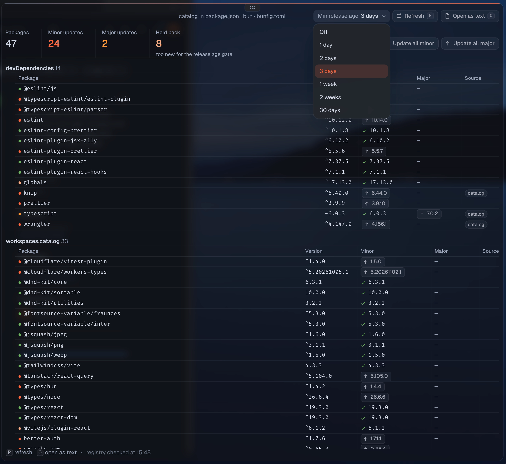

# JS Lib Versions

A plugin for the [Tern](https://docs.stencil.so/tern/) terminal that opens a `package.json` as a table of its dependencies. For each dependency it shows the newest minor and major release you can install, and you can update it with one click.



## What it does

- Opening a `package.json` (from the Files pane, the palette, a path clicked in a pane, or `tern open`) shows this table instead of the editor. **Open as text** (`o`) opens the file in the editor, and the palette command *Toggle JS lib versions for package.json opens* turns the takeover off. *Open with › JS Lib Versions* always works.
- Dependencies that point at a workspace catalog (`catalog:`) are resolved through it, whether the catalog lives in `pnpm-workspace.yaml`, a Bun workspace's root `package.json`, or Yarn's `.yarnrc.yml`. Updates are written to the catalog entry.
- **Minor** is the newest release in the dependency's current major; **Major** is the newest release in a newer major. The button beside a version rewrites the spec in place and keeps its `^` or `~`. **Update all minor** and **Update all major** write every update in that column at once.
- Releases younger than the package manager's minimum release age are held back and never offered, which keeps a freshly published, possibly compromised version out of your project. A held release is named in the row's tooltip. The plugin reads the same settings the package manager does:

  | Package manager | Settings | Read from |
  | --- | --- | --- |
  | Bun | `minimumReleaseAge`, `minimumReleaseAgeExcludes` | `bunfig.toml`, `~/.bunfig.toml` |
  | pnpm | `minimumReleaseAge` (`minimum-release-age` in `.npmrc`), `minimumReleaseAgeExclude` | `pnpm-workspace.yaml`, `.npmrc`, pnpm's global config |
  | Yarn | `npmMinimalAgeGate`, `npmPreapprovedPackages` | `.yarnrc.yml` in the project, its parent folders and the home folder |
  | npm | `min-release-age`, `before` | `.npmrc`, `~/.npmrc` |

  The **Min release age** menu in the header changes the setting in the project's config file. If a setting can't be read, every update is held.
- Version data comes from the [deps.dev](https://deps.dev) API and is cached for an hour; **Refresh** (`r`) fetches it again.

## Install

```sh
tern plugin install github.com/Artimunor/tern-js-lib-versions
```

To work on a checkout instead, run `tern plugin link <dir>`. `tern plugin types .` writes the `tern.d.luau` declarations that luau-lsp needs to type-check the plugin.
